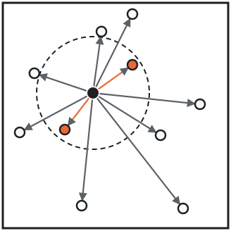
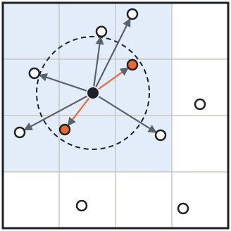
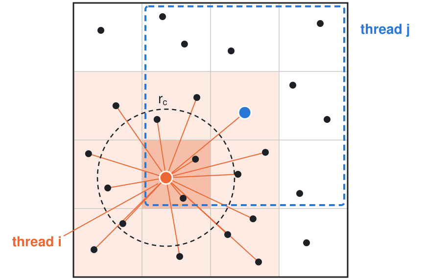
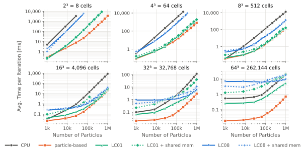
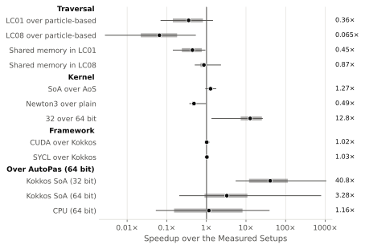

# LinkedCellsGPU

<!-- TODO: replace THESIS_URL with the link to the thesis once it is available -->
[](THESIS_URL)

This is the code base of my master's thesis *Linked Cells Algorithms for GPU*
(Technical University of Munich, Chair of Scientific Computing). It is a simplified
linked-cells molecular dynamics simulation (short-range pairwise forces, e.g.
Lennard-Jones) implemented on the GPU with three programming models — Kokkos,
native CUDA and SYCL (AdaptiveCpp) — sharing one code base, so the backends,
memory layouts (SoA / AoS) and traversal strategies can be compared directly.
Since the focus was comparison of a bigger amount of force calculation traversals and containers, 
the simulation itself is kept simple: no thermostats, no periodic boundaries, no MPI, no neighbor lists, and only one force functor (Lennard-Jones) plus three synthetic ones for testing.
We give a short overview here, but for more information see the thesis.

## Background: Linked Cells on the GPU

Molecular dynamics (MD) integrates Newton's equations of motion for N particles
over many timesteps, and computing the pairwise forces dominates the runtime.
For short-range potentials such as Lennard-Jones, the force is negligible beyond
a cutoff radius r<sub>c</sub>. The direct sum still checks every pair, O(N²).
**Linked Cells** sorts the particles into cells of size r<sub>c</sub>, so only
the neighboring cells have to be searched, which scales with O(N):

<p align="center">
  
  &nbsp;&nbsp;&nbsp;&nbsp;
  
  <br><em>Direct sum (left) vs. Linked Cells (right): only the pairs inside the cutoff (orange) contribute.</em>
</p>

A GPU trades the few complex cores of a CPU for thousands of simple ones and a
much wider memory bus, but it needs tens of thousands of independent threads and
coalesced memory accesses to be busy. The classic CPU traversals (LC01, LC08 with
coloring and Newton's third law) are therefore adapted: all particles live in one
flat array, sorted by cell with a counting sort, and an offset array gives each
cell's range. The **particle-based traversal** runs one thread per particle,
which reads the 27 neighbor cells and writes only its own force:

<p align="center">
  
</p>

Measured on an RTX 3080 over 60 setups (particle count × cell count), the
simplest approach performed best:

- The particle-based traversal is the fastest in 57 of 60 setups; grouping
  threads by cell, shared memory and Newton3 with atomics all cost more in
  coordination than they save in work.
- SoA beats AoS by 1.09–1.47×, and 32 bit is up to 26× faster than 64 bit on
  this consumer GPU.
- Kokkos, CUDA and SYCL perform within a few percent of each other.

<p align="center">
  
  <br><em>Force calculation time of the traversals (Kokkos, SoA, 32 bit) against the CPU reference.</em>
</p>

<p align="center">
  
  <br><em>All comparisons: geometric mean, quartiles and range over the measured setups.</em>
</p>

## Repository contents

```
CMakeLists.txt     top-level build: backend selection, fetches fkYAML and Kokkos
src/
  container/       particle containers per backend (SoA / AoS), sorted by cell
  traversal/       force traversals per backend (particle-based, LC01, LC08, shared memory variants)
  functors/        Lennard-Jones and synthetic force functors, time integration
  simulation/      picks container and traversal for the configured algorithm
test/              force test per backend against an O(N²) reference
config/            example configs
scripts/           build script and Nsight Compute profiling scripts
docs/figures/      figures of this README
```

## Backends

Each build directory holds exactly one backend, selected with `LC_BACKEND`:

| `LC_BACKEND`   | Toolchain                               | Algorithms in the build |
|----------------|-----------------------------------------|-------------------------|
| `kokkos`       | clang + Kokkos (CUDA backend)           | `cpu`, `kokkos-soa`, `kokkos-soa-newton3`, `kokkos-aos`, `kokkos-c01-soa`, `kokkos-c01-aos`, `kokkos-c01-scratch-soa`, `kokkos-c01-scratch-aos`, `kokkos-c08-soa`, `kokkos-c08-scratch-soa` |
| `cuda`         | clang in CUDA mode, no Kokkos           | `cuda-soa`, `cuda-aos` |
| `sycl-cuda`    | AdaptiveCpp, target `cuda:sm_XX`        | `sycl-soa`, `sycl-aos` |
| `sycl-generic` | AdaptiveCpp, generic (SSCP) target      | `sycl-soa`, `sycl-aos` |

## Setup

Tested on Ubuntu 24.04 (WSL2) with an RTX 3060 (sm_86), clang 18 and CUDA 12.0.

### Required for all backends

- CMake >= 3.22
- clang (the CUDA code is compiled by clang, not nvcc) with OpenMP
- CUDA toolkit (clang 18 supports CUDA up to 12.3)

```sh
sudo apt install cmake clang libomp-18-dev
```

`clang` provides the unversioned `clang++` the build script uses by default; without
it, pass `CXX=clang++-18`. Install the CUDA toolkit from NVIDIA.

[fkYAML](https://github.com/fktn-k/fkYAML) (YAML parser) and
[Kokkos](https://github.com/kokkos/kokkos) are downloaded automatically by CMake
during the first configure, so that needs network access.

### Additionally for the SYCL backends: AdaptiveCpp

AdaptiveCpp is not packaged for Ubuntu and is built from source against the
system LLVM 18:

```sh
sudo apt install git llvm-18-dev libclang-18-dev libclang-cpp18-dev lld-18 \
                 libboost-context-dev libboost-fiber-dev ninja-build

export ACPP_ROOT=$HOME/adaptivecpp     # source, build and install all go here

git clone https://github.com/AdaptiveCpp/AdaptiveCpp $ACPP_ROOT/src
git -C $ACPP_ROOT/src checkout $(git -C $ACPP_ROOT/src describe --tags --abbrev=0)

cmake -S $ACPP_ROOT/src -B $ACPP_ROOT/build -G Ninja \
  -DCMAKE_INSTALL_PREFIX=$ACPP_ROOT/install \
  -DCMAKE_CXX_COMPILER=clang++-18 \
  -DLLVM_DIR=/usr/lib/llvm-18/cmake \
  -DCLANG_EXECUTABLE_PATH=/usr/bin/clang++-18 \
  -DWITH_CUDA_BACKEND=ON -DCUDAToolkit_ROOT=/usr/local/cuda-12.0 \
  -DWITH_ROCM_BACKEND=OFF -DWITH_OPENCL_BACKEND=OFF -DWITH_LEVEL_ZERO_BACKEND=OFF
cmake --build $ACPP_ROOT/build -j && cmake --install $ACPP_ROOT/build
```

Make it visible to the shell and to CMake (e.g. in `~/.zshrc`):

```sh
export ACPP_ROOT=$HOME/adaptivecpp
export PATH=$ACPP_ROOT/install/bin:$PATH
export CMAKE_PREFIX_PATH=$ACPP_ROOT/install:$CMAKE_PREFIX_PATH
```

`acpp-info -l` should then list the GPU under the CUDA backend. On WSL the CUDA
driver lives in `/usr/lib/wsl/lib`; add it to `LD_LIBRARY_PATH` if no device shows up.

## Building

From the project root:

```sh
bash scripts/build/build.sh [32|64] [backend ...]
```

```sh
bash scripts/build/build.sh                    # all four backends, 32 bit
bash scripts/build/build.sh 64 kokkos cuda     # only these, 64 bit
```

- `32` builds with `float` and 32-bit particle ids, `64` with `double` and 64-bit
  ids (CMake option `USE_64_BIT`).
- Each backend goes to `build-<backend>/`; the program is `build-<backend>/src/main`.
- Environment variables: `CXX` (default `clang++`), `ARCH` (compute capability,
  default `86`), `BUILD_TYPE` (default `Release`).

The script is a thin wrapper; the equivalent manual commands are, e.g.:

```sh
cmake -S . -B build-cuda -DCMAKE_BUILD_TYPE=Release -DCMAKE_CXX_COMPILER=clang++ \
      -DLC_BACKEND=cuda -DUSE_64_BIT=OFF -DLC_CUDA_ARCH=sm_86
cmake --build build-cuda -j
```

For `kokkos` add `-DKokkos_ENABLE_SERIAL=ON -DKokkos_ENABLE_OPENMP=ON
-DKokkos_ENABLE_CUDA=ON -DKokkos_ARCH_AMPERE86=ON`. Always configure from the
project root (`-S .`), never from `src/`: the dependencies are fetched in the
top-level `CMakeLists.txt`.

## Running

```sh
build-<backend>/src/main <config.yaml>
build-<backend>/src/main --help      # lists every key and the algorithms of this build
```

The YAML config is the only input. Every key is mandatory except `output_dir`,
and unknown keys are rejected:

```yaml
delta_t: 0.01
end_t: 1.0                       # iterations run until the time passes end_t
domain_size: [10.0, 10.0, 10.0]  # domain is [0, 0, 0] to domain_size
interaction_radius: 1.0          # cutoff; cells are at least this large
epsilon: 1.0                     # Lennard-Jones well depth
sigma: 0.4                       # Lennard-Jones zero-crossing distance
algorithm: kokkos-soa            # must be compiled into this build, see Backends
functor: lj                      # lj | high | low | full
only_forces: false               # true: repeat rebuild + force calculation only
output_vtk_files: true           # per-timestep snapshots; needs output_dir
output_dir: "./output"           # optional
initializers:                    # applied in order
  - type: random
    num_particles: 1000
    box_min: [0.0, 0.0, 0.0]
    box_max: [10.0, 10.0, 10.0]
  - type: cuboid
    box_min: [0.0, 0.0, 0.0]
    box_max: [5.0, 5.0, 5.0]
    grid_counts: [10, 10, 10]
```

Functors:

- `lj`: Lennard-Jones
- `high`: synthetic, high arithmetic intensity
- `low`: synthetic, as little work as possible
- `full`: synthetic, cheap but reads every input of both particles (id, position, velocity)

Modes:

- `only_forces: false` runs the full simulation. Each timestep resets the forces,
  rebuilds the cells, computes the pairwise forces and integrates, optionally
  writing a VTK snapshot.
- `only_forces: true` only times the rebuild and the force calculation, with no
  integration and no output.

Output: the console shows the per-section timing summary. With `output_dir` set,
the directory gets:

- `config.yaml`: a copy of the input
- `timings.csv`: per-iteration timings of every section
- `summary.txt`: parameters and the timing summary
- `vtk_output/`: the cell grid and per-timestep particle snapshots, e.g. for
  ParaView (only with `output_vtk_files`)

The program refuses to run if `output_dir` already exists, so earlier results
are never overwritten.

Examples (`test_random.yaml` uses `cpu`, which is in the kokkos build):

```sh
build-kokkos/src/main config/test_random.yaml
build-kokkos/src/main config/test_grid.yaml     # writes ./testoutput
```

## Tests

Each backend builds one force test that compares its containers and traversals
against an O(N^2) reference:

```sh
ctest --test-dir build-<backend> --output-on-failure
```

## Benchmarks and profiling

- `build-kokkos/benchmarks/sorting -n <count> [-b bins] [-v value arrays]
  [-r repetitions] [-w warmup] [-o csv dir]`: Kokkos sorting benchmark.
- `scripts/ncu-traversal/ncu-traversal.sh` and
  `scripts/ncu-rebuild/ncu-rebuild.sh`: profile the force and rebuild kernels of
  every implementation with Nsight Compute. They need `ncu` on `PATH` and the
  build directories listed in their `kernels.txt`. Options are documented in the
  script headers.
